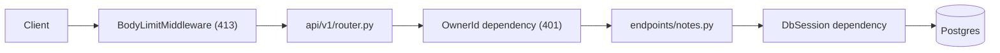

# Architecture

`template-python` is one FastAPI process in front of one Postgres database. Routes live under `src/app/api/v1`, take the caller identity and a database session as dependencies, and return Pydantic models. Settings, the identity check, the body limit and the database engine live in `src/app/core`. Alembic owns the schema. Every rule that can be machine-checked is enforced by a tool in `make check`.

## Request flow

## Code map

Check this table before you write a helper. If a row fits, reuse it.

| Path | Responsibility | Reuse, don't recreate |
| --- | --- | --- |
| `src/app/main.py` | Builds the app, registers middleware and the v1 router, disposes the engine on shutdown. | Add routes through `src/app/api/v1/router.py`, not here. |
| `src/app/core/config.py` | The only place that reads environment variables. | Import `settings`. |
| `src/app/core/auth.py` | Caller identity. Validates bearer tokens first, else the dev header behind the guard. | Declare `owner_id: OwnerId`. |
| `src/app/core/jwt.py` | Bearer validation against the product JWKS. | Call `token_owner_id`; never parse tokens elsewhere. |
| `src/app/core/body_limit.py` | Rejects oversized bodies with a JSON 413. | Set `MAX_REQUEST_BODY_BYTES`. |
| `src/app/core/errors.py` | Renders 422 validation errors as `{"detail": [...]}` without echoing the input. | Register new exception handlers in `src/app/main.py`. |
| `src/app/core/database.py` | Async engine and session factory. | Declare `db: DbSession`. |
| `src/app/models/` | SQLAlchemy models. Import each model in `src/app/models/__init__.py` so Alembic sees it. | Subclass `Base` from `src/app/models/base.py`. |
| `src/app/schemas/` | Pydantic request and response models. | Mirror `src/app/schemas/note.py`. Use `StorableText`, `RowId` and `ErrorResponse` from `src/app/schemas/common.py`. |
| `src/app/api/v1/endpoints/` | One module per feature. | Look up owned rows with `get_owned_note` in `notes.py`; copy that shape for new entities. |
| `src/app/api/v1/router.py` | Registers feature routers. | One `include_router` line per feature. |
| `alembic/versions/` | Migrations, generated with `make db-revision`. | Never edit an applied migration. |
| `tests/` | API tests through `httpx.AsyncClient`. | Use the `client` fixture in `tests/conftest.py`. |
| `scripts/repo-policy.mjs` | Layout, docs, ledger and drift checks. | Configure it in `scripts/repo-policy.json`; do not edit the script. |
| `scripts/check_licenses.py`, `scripts/check_new_deps.py`, `scripts/check_spec.py` | Licence, supply-chain and contract gates. | Run them through `make licenses`, `make security` and `make spec-check`. |
| `clients/` | Committed `clients/openapi.json` and generated TypeScript client. | Regenerate with `make openapi` and `make client`; never edit `clients/ts/` by hand. |
| `scripts/agent-hook.sh` | Format-on-edit and verify-on-stop hooks for agents. | Keep the `post-edit` and `stop` modes. |
| `.ast-grep/` | Anti-slop and boundary rules with tests. | Add a rule and a test together. |

## Invariants

- Only `src/app/core/config.py` reads the environment. [enforced by ast-grep]
- No function body is only `pass` or `...`. [enforced by ast-grep]
- Every top-level directory is listed in `scripts/repo-policy.json` under `layout.allow`; nested directories are free. [enforced by `make policy`]
- Every direct dependency has a row in `docs/dependencies.md`. [enforced by `make policy`]
- Types are strict. [enforced by Mypy]
- Queries filter by `owner_id`; a row owned by someone else returns 404. [enforced by `tests/test_notes.py`]
- A request without a trusted identity returns 401. [enforced by `tests/test_identity.py`]
- Bearer tokens validate against the JWKS with issuer, audience and expiry checks; failures return 401 without details. [enforced by `tests/test_jwt.py`]
- The dev identity shortcut runs only in development and test; the app refuses to boot with it set elsewhere. [enforced by `tests/test_identity.py`]
- The committed OpenAPI spec and TypeScript client match the app. [enforced by `make spec-check`]
- Endpoints return Pydantic models, never ORM instances. [review-only]
- Endpoints own the transaction commit. [review-only]
- Every error body has the shape `{"detail": ...}`. [review-only]

## Cross-cutting concerns

| Concern | How it works |
| --- | --- |
| Config | `Settings` in `src/app/core/config.py` loads environment variables and `.env`. |
| Errors | Handlers raise `HTTPException`. Every error renders as `{"detail": ...}`: 400, 401, 404, 413 and 422. |
| Auth | `get_owner_id` validates a bearer token against the JWKS first, else reads `x-user-id` only when the dev shortcut is enabled. Point `JWKS_URL`, `JWT_ISSUER` and `JWT_AUDIENCE` at the product; the swap points are marked in the files. |
| Logging | Uvicorn access logs. SQL echo with `DEBUG=true`. |
| Database | One async engine per process. The session lives for one request. |
| Migrations | Alembic, async `env.py`. Run `make db-migrate`. |
